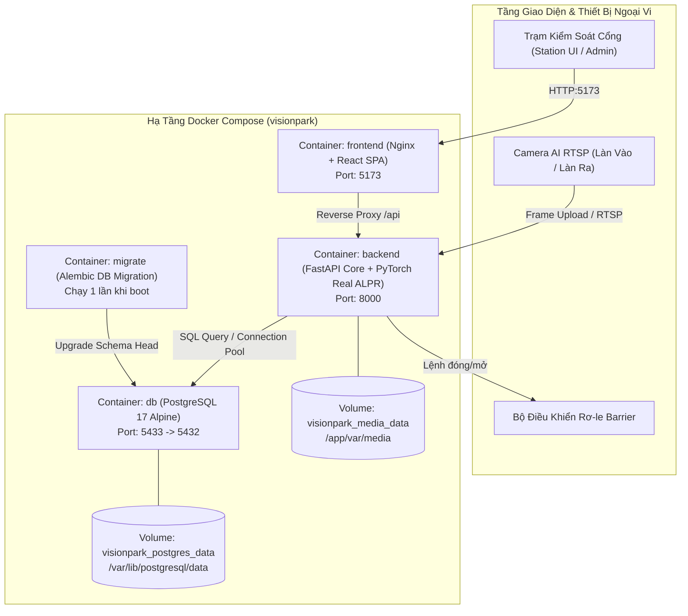

# SỔ TAY VẬN HÀNH & BÀN GIAO HỆ THỐNG VISIONPARK
## System Handover & Operational Runbook — Môi Trường Triển Khai Docker Compose

> **Dự án**: VisionPark — Hệ Thống Quản Lý Bãi Đỗ Xe Thông Minh Tích Hợp AI & PCCC  
> **Phiên bản tài liệu**: 2.0 (Bàn giao vận hành chính thức)  
> **Bộ phận phụ trách**: DevOps & QA Engineering (Thành viên 1)  
> **Đối tượng sử dụng**: Kỹ sư Triển khai (DevOps Engineer), Quản trị viên Hệ thống (System Admin), Đội ngũ Bảo trì IT Tòa nhà  
> **Ngày phê duyệt**: Tháng 11/2026  

---

## MỤC LỤC
1. [Kiến Trúc Triển Khai & Container Topology](#1-kiến-trúc-triển-khai--container-topology)
2. [Cấu Hình Môi Trường (.env) Toàn Diện](#2-cấu-hình-môi-trường-env-toàn-diện)
3. [Quy Trình Cài Đặt & Khởi Động Bằng Docker Compose](#3-quy-trình-cài-đặt--khởi-động-bằng-docker-compose)
4. [Quy Trình Sao Lưu & Phục Hồi Dữ Liệu (Docker Volume Backup & Disaster Recovery)](#4-quy-trình-sao-lưu--phục-hồi-dữ-liệu-docker-volume-backup--disaster-recovery)
5. [Quy Trình Xử Lý Sự Cố Mất Điện Đột Ngột & Khởi Động Lại Máy Chủ](#5-quy-trình-xử-lý-sự-cố-mất-điện-đột-ngột--khởi-động-lại-máy-chủ)
6. [Checklist Giám Sát Sức Khỏe Hệ Thống (Health Check & Observability)](#6-checklist-giám-sát-sức-khỏe-hệ-thống-health-check--observability)
7. [Tiêu Chuẩn Nghiệm Thu Cuối Cùng (Release Gate Checklist)](#7-tiêu-chuẩn-nghiệm-thu-cuối-cùng-release-gate-checklist)

---

## 1. KIẾN TRÚC TRIỂN KHAI & CONTAINER TOPOLOGY

VisionPark được đóng gói hoàn chỉnh dưới dạng các micro-services vận hành trên nền tảng Docker và Docker Compose, bảo đảm tính độc lập, dễ dàng scale và di chuyển giữa các máy chủ biên (Edge Server) tại bãi xe.



### 1.1. Danh mục Services trong `docker-compose.yml`
| Tên Service | Image / Base | Cổng Expose | Chức năng chính |
| :--- | :--- | :--- | :--- |
| `db` | `postgres:17-alpine` | `5433:5432` | Lưu trữ toàn bộ dữ liệu nghiệp vụ, giao dịch, hợp đồng tháng, audit log |
| `migrate` | Build từ `./backend` | *(Không)* | Tự động áp dụng Alembic migration nâng cấp schema DB khi khởi động |
| `backend` | Build từ `./backend` | `8000:8000` | API FastAPI, mô hình AI ALPR PyTorch inference, tính phí, quản lý làn |
| `frontend` | Build từ `./frontend` | `5173:80` | Giao diện điều khiển cổng Station UI và trang Quản trị Admin Dashboard |

### 1.2. Danh mục Docker Volumes cần bảo vệ tuyệt đối
1. **`visionpark_postgres_data`**: Lưu trữ toàn bộ database PostgreSQL 17 (chứa dữ liệu nhạy cảm: thông tin xe, lịch sử thanh toán tiền mặt, tài khoản người dùng, cấu hình bãi).
2. **`visionpark_media_data`**: Lưu trữ toàn bộ ảnh chụp hiện trường xe vào, ảnh xe ra và bằng chứng bounding box của thuật toán AI ALPR.

---

## 2. CẤU HÌNH MÔI TRƯỜNG (.ENV) TOÀN DIỆN

Trước khi khởi chạy hệ thống, sao chép file mẫu `env.example` thành file `.env` tại thư mục gốc của dự án (`E:\BE_AI\VisionPark\.env`).

### 2.1. Bảng tra cứu thông số môi trường chuẩn Production
```ini
# ==============================================================================
# 1. CẤU HÌNH CƠ SỞ DỮ LIỆU POSTGRESQL (DOCKER SERVICE DB)
# ==============================================================================
POSTGRES_DB=visionpark
POSTGRES_USER=visionpark
POSTGRES_PASSWORD=visionpark_secure_pass_2026!
POSTGRES_PORT=5433

# Chuỗi kết nối DatabaseURL cho backend kết nối nội bộ container
DATABASE_URL=postgresql+psycopg://visionpark:visionpark_secure_pass_2026!@db:5432/visionpark

# ==============================================================================
# 2. BẢO MẬT & XÁC THỰC (JWT AUTHENTICATION)
# ==============================================================================
# BẮT BUỘC ĐỔI: Khóa bí mật dùng để ký token JWT. Tuyệt đối không dùng chuỗi mặc định!
# Tạo chuỗi ngẫu nhiên bằng lệnh: openssl rand -hex 32
JWT_SECRET_KEY=9a8b7c6d5e4f3a2b1c0d9e8f7a6b5c4d3e2f1a0b9c8d7e6f5a4b3c2d1e0f9a8b

ENVIRONMENT=production
CORS_ORIGINS=http://localhost:5173,http://127.0.0.1:5173

# ==============================================================================
# 3. CẤU HÌNH AI COMPUTER VISION (ALPR & OCR)
# ==============================================================================
# Chế độ AI: "real" (sử dụng model YOLO + PaddleOCR thật), "mock" (chỉ dùng cho CI/CD)
ALPR_PROVIDER=real
ALPR_MANIFEST_PATH=models/alpr-manifest.json

# Thiết bị tính toán: "cpu" (mặc định bãi xe thông thường) hoặc "cuda" (nếu có GPU rời)
ALPR_DEVICE=cpu

# Ngưỡng phát hiện bounding box biển số (0.0 - 1.0)
ALPR_DETECTOR_CONFIDENCE=0.25

# Ngưỡng tin cậy chấp thuận biển số tự động không cần hỏi (Threshold)
ALPR_CONFIDENCE_THRESHOLD=0.85

# Biên độ mở rộng ảnh cắt biển số để đưa vào OCR
ALPR_OCR_MARGIN=0.08

# Bật phân hệ bóc tách ký tự OCR
ALPR_OCR_ENABLED=true

# Cờ cài đặt thư viện AI trong Dockerfile
INSTALL_REAL_ALPR=true
INSTALL_OCR=true
INSTALL_TORCH_CPU=true

# ==============================================================================
# 4. LƯU TRỮ MEDIA VÀ BỘ NHỚ BIÊN
# ==============================================================================
LOCAL_STORAGE_PATH=/app/var/media

# ==============================================================================
# 5. KHỞI TẠO TÀI KHOẢN & NGHIỆP VỤ BÃI ĐỖ
# ==============================================================================
PUBLIC_REGISTRATION_ENABLED=false
AUTO_SEED=true
SEED_ADMIN_USERNAME=admin
SEED_ADMIN_PASSWORD=Admin@VisionPark2026

# ==============================================================================
# 6. CỔNG MẠNG DỊCH VỤ (NETWORK PORTS)
# ==============================================================================
BACKEND_PORT=8000
FRONTEND_PORT=5173
VITE_API_BASE_URL=/
VITE_API_TIMEOUT_MS=15000
```

> [!CAUTION]
> **Cảnh báo bảo mật quan trọng:**
> - Nếu biến `JWT_SECRET_KEY` giữ nguyên chuỗi `replace-this-with-a-long-random-secret`, backend sẽ tự động chặn khởi động và báo lỗi fatal.
> - `PUBLIC_REGISTRATION_ENABLED` phải luôn đặt là `false` để ngăn chặn kẻ gian tự tạo tài khoản truy cập vào hệ thống bãi xe.

---

## 3. QUY TRÌNH CÀI ĐẶT & KHỞI ĐỘNG BẰNG DOCKER COMPOSE

### 3.1. Yêu cầu phần cứng & môi trường tối thiểu
- **Hệ điều hành**: Windows 11 / Windows Server 2022 (hoặc Ubuntu 22.04 LTS).
- **CPU**: Tối thiểu 4 Cores (Khuyến nghị Intel Core i5 Gen 10 trở lên hoặc tương đương).
- **RAM**: Tối thiểu 8 GB (Khuyến nghị 16 GB để mô hình PyTorch và OCR chạy mượt mà trên CPU).
- **Ổ cứng**: SSD tối thiểu 50 GB trống (Dành cho Docker Images và lưu trữ ảnh chụp phương tiện).
- **Phần mềm bắt buộc**: Docker Desktop 4.25+ (hoặc Docker Engine 24.0+) kèm Docker Compose v2.

---

### 3.2. Các bước cài đặt từ Zero (Cold Start Deployment)

#### Bước 1: Kiểm tra trọng số Model AI (Weights Verification)
Đảm bảo file model YOLO đã được đặt đúng vị trí và kiểm tra mã băm SHA-256 khớp với manifest:
```powershell
# Di chuyển vào thư mục backend
cd E:\BE_AI\VisionPark\backend

# Kiểm tra sự tồn tại của model weights
Get-Item app/alpr/weights/best.pt

# Kiểm tra mã SHA-256 (phải khớp với models/alpr-manifest.json)
Get-FileHash app/alpr/weights/best.pt -Algorithm SHA256
```

#### Bước 2: Khởi tạo file cấu hình môi trường
```powershell
cd E:\BE_AI\VisionPark
Copy-Item env.example .env

# Chỉnh sửa các giá trị mật khẩu và JWT_SECRET_KEY an toàn
notepad .env
```

#### Bước 3: Build Image và Khởi động Container
Chạy lệnh khởi động trọn gói hệ thống:
```powershell
# Tải/build container và chạy nền (detached mode)
docker compose up -d --build
```

#### Bước 4: Kiểm tra tiến trình khởi động & Tự động Migration
Hệ thống sẽ tuân thủ đúng thứ tự phụ thuộc:
1. `db` khởi động trước và vượt qua kiểm tra sức khỏe `pg_isready`.
2. `migrate` chạy lệnh `alembic upgrade head` để cập nhật bảng dữ liệu lên phiên bản mới nhất.
3. `backend` nạp mô hình AI (Warmup PyTorch inference) và mở cổng 8000.
4. `frontend` khởi động Nginx mở cổng 5173.

Kiểm tra log của từng service:
```powershell
# Xem trạng thái tổng thể các container
docker compose ps

# Theo dõi log chi tiết của backend
docker compose logs -f backend
```
*Kỳ vọng trong log:* Xuất hiện dòng thông báo:  
`INFO: Application startup complete.`  
`WARNING: Real inference warmup: True`

---

## 4. QUY TRÌNH SAO LƯU & PHỤC HỒI DỮ LIỆU (DOCKER VOLUME BACKUP & DISASTER RECOVERY)

Dữ liệu bãi xe bao gồm tiền thu, nhật ký xe và ảnh chụp hiện trường là tài sản pháp lý của tòa nhà. Cần thiết lập quy trình sao lưu nghiêm ngặt.

```
                              [LƯU TRỮ NỘI BỘ DOCKER]
                                ├── visionpark_postgres_data (DB)
                                └── visionpark_media_data (Ảnh)
                                          │
                        ┌─────────────────┴─────────────────┐
                        ▼                                   ▼
              [Sao Lưu Cơ Sở Dữ Liệu]               [Sao Lưu File Media]
               pg_dump -> .sql.gz                   tar -> .tar.gz
                        └─────────────────┬─────────────────┘
                                          ▼
                               [THƯ MỤC BACKUP AN TOÀN]
                             D:\VisionPark_Backups\YYYY-MM-DD\
```

### 4.1. Kịch bản sao lưu nóng định kỳ (Hot Backup Script)

Tạo file script PowerShell tự động sao lưu: `scripts/backup_system.ps1`:
```powershell
# scripts/backup_system.ps1
$Timestamp = Get-Date -Format "yyyyMMdd_HHmmss"
$BackupDir = "D:\VisionPark_Backups\$Timestamp"
New-Item -ItemType Directory -Force -Path $BackupDir | Out-Null

Write-Host "[1/3] Đang sao lưu PostgreSQL Database..." -ForegroundColor Cyan
# Sử dụng lệnh pg_dump trực tiếp trong container db
docker compose exec -T db pg_dump -U visionpark visionpark | gzip > "$BackupDir\visionpark_db_$Timestamp.sql.gz"

Write-Host "[2/3] Đang sao lưu Docker Media Volume (Ảnh xe vào/ra)..." -ForegroundColor Cyan
# Mount volume media vào container phụ alpine để nén ảnh
docker run --rm `
    -v visionpark_media_data:/source_media:ro `
    -v ${BackupDir}:/backup_dest `
    alpine tar czf /backup_dest/visionpark_media_$Timestamp.tar.gz -C /source_media .

Write-Host "[3/3] Sao lưu cấu hình .env..." -ForegroundColor Cyan
Copy-Item .env "$BackupDir\.env.backup"

Write-Host "[SUCCESS] Quá trình sao lưu hoàn tất tại: $BackupDir" -ForegroundColor Green
```

---

### 4.2. Quy trình phục hồi dữ liệu từ bản Backup (Full Restore Procedure)

Khi máy chủ bị hỏng ổ cứng hoặc cần chuyển sang máy chủ dự phòng, thực hiện quy trình 5 bước sau:

#### Bước 1: Dừng các container đang chạy
```powershell
cd E:\BE_AI\VisionPark
docker compose down
```

#### Bước 2: Xóa bỏ volume cũ (nếu bị hỏng dữ liệu)
```powershell
docker volume rm visionpark_postgres_data
docker volume rm visionpark_media_data
```

#### Bước 3: Khởi động service DB rỗng
```powershell
docker compose up -d db
# Chờ 10 giây để PostgreSQL khởi tạo cụm dữ liệu mới
Start-Sleep -Seconds 10
```

#### Bước 4: Bơm dữ liệu database từ bản sao lưu `.sql.gz`
```powershell
$BackupFile = "D:\VisionPark_Backups\20261102_120000\visionpark_db_20261102_120000.sql.gz"

# Giải nén và nạp vào PostgreSQL
gzip -dc $BackupFile | docker compose exec -T db psql -U visionpark -d visionpark
```

#### Bước 5: Phục hồi hình ảnh vào volume `visionpark_media_data`
```powershell
$MediaBackup = "D:\VisionPark_Backups\20261102_120000\visionpark_media_20261102_120000.tar.gz"

docker run --rm `
    -v visionpark_media_data:/dest_media `
    -v "D:\VisionPark_Backups\20261102_120000":/backup_src `
    alpine sh -c "tar xzf /backup_src/visionpark_media_20261102_120000.tar.gz -C /dest_media"
```

#### Bước 6: Khởi động lại toàn bộ hệ thống
```powershell
docker compose up -d
docker compose ps
```

---

## 5. QUY TRÌNH XỬ LÝ SỰ CỐ MẤT ĐIỆN ĐỘT NGỘT & KHỞI ĐỘNG LẠI MÁY CHỦ

Bãi đỗ xe luôn đối mặt với rủi ro mất điện lưới đột ngột hoặc sập nguồn máy chủ. VisionPark được thiết kế với cơ chế tự phục hồi cao (Resilience by Design).

### 5.1. Cơ chế an toàn dữ liệu tích hợp
1. **Chính sách tự khởi động container**: Toàn bộ các dịch vụ trọng yếu (`db`, `backend`, `frontend`) đều cấu hình `restart: unless-stopped`. Khi máy chủ được cấp điện trở lại và bật nguồn, Docker Engine sẽ tự động khởi chạy lại hệ thống mà không cần người dùng can thiệp thủ công.
2. **Cơ chế Write-Ahead Logging (WAL) của PostgreSQL 17**: Mọi giao dịch tiền mặt và check-in/out đều được commit đồng bộ vào ổ đĩa. Khi mất điện bất ngờ, PostgreSQL sẽ tự động quét file WAL để tự phục hồi (Crash Recovery) và đưa cơ sở dữ liệu về trạng thái nhất quán 100%.
3. **Idempotency Key Guard**: Các giao dịch check-in/check-out đang dở dang khi bị ngắt kết nối sẽ không bị tính tiền hai lần khi nhân viên bấm gửi lại yêu cầu.

### 5.2. Các bước xử lý của nhân viên IT sau sự cố mất điện

```
[MÁY CHỦ CÓ ĐIỆN TRỞ LẠI]
           │
           ▼
[Bước 1]: Kiểm tra Docker Service (docker compose ps)
           │
           ├──> Nếu container EXIT: Thực hiện `docker compose up -d`
           │
           ▼
[Bước 2]: Kiểm tra Endpoint Sức Khỏe (curl http://localhost:8000/health/ready)
           │
           ├──> Database: READY
           └──> ALPR AI: READY
           │
           ▼
[Bước 3]: Kiểm tra Trạng Thái Barrier Ngoại Vi & Bộ Đếm Chỗ Đỗ
           │
           └──> Đảm bảo cổng không bị kẹt cơ khí
           │
           ▼
[Bước 4]: Mở Trạm Kiểm Soát Station UI (http://localhost:5173) đón xe bình thường
```

---

## 6. CHECKLIST GIÁM SÁT SỨC KHỎE HỆ THỐNG (HEALTH CHECK & OBSERVABILITY)

### 6.1. Chi tiết các Endpoints Giám Sát

#### 1. Liveness Probe (`GET /health/live`)
- **Mục đích**: Kiểm tra xem tiến trình FastAPI có đang chạy hay không.
- **URL**: `http://localhost:8000/health/live`
- **Kết quả HTTP 200 chuẩn**:
  ```json
  {
    "status": "alive",
    "version": "0.1.0"
  }
  ```

#### 2. Readiness Probe (`GET /health/ready`)
- **Mục đích**: Kiểm tra toàn diện xem hệ thống đã sẵn sàng đón xe hay chưa (Database kết nối tốt + Model AI đã tải vào RAM + OCR đã kích hoạt).
- **URL**: `http://localhost:8000/health/ready`
- **Kết quả HTTP 200 chuẩn (Sẵn sàng phục vụ)**:
  ```json
  {
    "status": "ready",
    "version": "0.1.0",
    "database": {
      "ready": true,
      "dialect": "postgresql"
    },
    "alpr": {
      "ready": true,
      "provider": "real",
      "device": "cpu",
      "model_version": "yolov8-plate-v2",
      "ocr_enabled": true
    },
    "correlation_id": "c7a8b9e1-2f3a-4b5c-6d7e-8f9a0b1c2d3e"
  }
  ```
- **Kết quả HTTP 503 (Cảnh báo sự cố)**:
  Nếu database mất kết nối hoặc file trọng số AI bị mất, endpoint sẽ trả về HTTP 503 kèm chi tiết nguyên nhân, giúp hệ thống cảnh báo sớm cho kỹ thuật viên.

---

### 6.2. Ma trận xử lý sự cố nhanh (Troubleshooting Matrix - 2 Phút)

| Triệu chứng sự cố | Nguyên nhân khả dĩ | Lệnh kiểm tra | Biện pháp xử lý tức thời |
| :--- | :--- | :--- | :--- |
| **Giao diện Station UI báo "Mất kết nối Backend"** | Container backend bị dừng hoặc chưa khởi động xong | `docker compose ps` | Chạy `docker compose restart backend`. Kiểm tra log bằng `docker compose logs --tail 50 backend`. |
| **`/health/ready` trả về HTTP 503 ở phần ALPR** | File `best.pt` thiếu hoặc sai đường dẫn, hoặc RAM bị quá tải | `docker compose logs backend \| grep alpr` | Kiểm tra file `backend/app/alpr/weights/best.pt`, tăng RAM Docker Desktop lên tối thiểu 8GB. |
| **Không đăng nhập được tài khoản Operator** | Chưa chạy seed dữ liệu hoặc sai thông tin xác thực | `docker compose logs migrate` | Chạy lệnh gieo tài khoản thủ công: `docker compose exec backend python -m app.database.seed_demo`. |
| **Barrier không nâng khi thu tiền xong** | Cáp mạng rơ-le barrier lỏng hoặc cấu hình sai IP làn | Màn hình cài đặt Làn `/lanes` | Kiểm tra nguồn điện Barrier, kiểm tra log `BARRIER_OPEN_FAILED` trong bảng `audit_logs`. |
| **Ổ cứng máy chủ báo đầy (Disk Full)** | Ảnh media lưu trữ qua nhiều tháng chiếm dụng dung lượng | `docker system df` | Chạy script sao lưu định kỳ và dọn dẹp các bản build cũ: `docker image prune -f`. |

---

## 7. TIÊU CHUẨN NGHIỆM THU CUỐI CÙNG (RELEASE GATE CHECKLIST)

Bảng tiêu chuẩn nghiệm thu kỹ thuật bắt buộc phải vượt qua trước khi ký biên bản bàn giao chính thức cho đơn vị vận hành bãi xe:

### Cổng 1: Kiểm thử mã nguồn & Build tự động (Gate 1 - Quality)
- [x] Kiểm thử tự động Backend (Pytest): `100% tests PASS` (Bao gồm unit test, idempotency, counter atomic).
- [x] Kiểm thử giao diện Frontend (Vitest & Lint): `npm run test` và `npm run build` không phát sinh cảnh báo lỗi.
- [x] Cơ chế Migration DB: Alembic nâng cấp `head` trơn tru trên PostgreSQL 17 sạch.

### Cổng 2: Hiệu năng & Độ chính xác AI ALPR (Gate 2 - Performance)
- [x] Độ chính xác nhận diện biển số (Accuracy Benchmark): Đạt $\ge 95\%$ trên tập dữ liệu kiểm thử thực tế.
- [x] Tốc độ suy luận AI (Inference Latency): Thời gian bóc tách biển số $\le 300\text{ ms}$ trên phần cứng CPU thông dụng.
- [x] Tự động kích hoạt cơ chế OCR phục hồi khi biển số có độ tin cậy thấp.

### Cổng 3: Nghiệp vụ Tiền Mặt & An Toàn Tài Chính (Gate 3 - Cash Business)
- [x] Quy trình check-out thu tiền mặt hoàn thành trong $\le 3\text{ giây}$.
- [x] Lưu trữ độc lập bản chụp giá (`price_snapshot`), biến động giá mới không làm sai lệch tiền của xe đang gửi trong bãi.
- [x] Báo cáo cuối ca khớp $100\%$ giữa tổng tiền mặt thu được và số liệu trên hệ thống.
- [x] $100\%$ các thao tác nhập tay (F2) và báo mất vé (F5) được ghi vết vào sổ kiểm toán (Audit Trail) kèm ảnh gốc.

### Cổng 4: Sẵn Sàng Vận Hành & An Toàn PCCC (Gate 4 - Operations & Safety)
- [x] Tính năng xả trạm khẩn cấp PCCC kích hoạt mở barrier tức thời $\le 500\text{ ms}$.
- [x] Quy trình sao lưu và phục hồi dữ liệu Docker Volume được diễn tập thành công trên môi trường thực tế.
- [x] Các endpoint `/health/live` và `/health/ready` phản hồi trạng thái khỏe mạnh.

---

### BIÊN BẢN XÁC NHẬN BÀN GIAO & NGHIỆM THU
*Hôm nay, ngày ..... tháng ..... năm 2026, tại Trạm chỉ huy bãi đỗ xe VisionPark:*

- **Đại diện Đội ngũ Phát triển (QA / DevOps Lead)**:  
  *(Ký và ghi rõ họ tên)*

- **Đại diện Ban Quản trị Vận hành Bãi xe (System Admin)**:  
  *(Ký và ghi rõ họ tên)*

- **Đại diện Hội đồng Đánh giá / Giảng viên Hướng dẫn**:  
  *(Ký và ghi rõ họ tên)*
