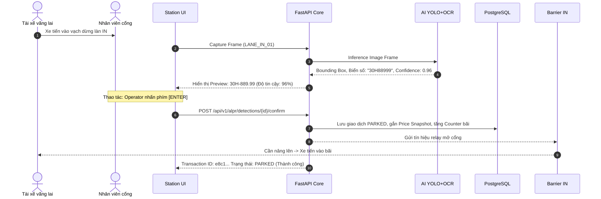
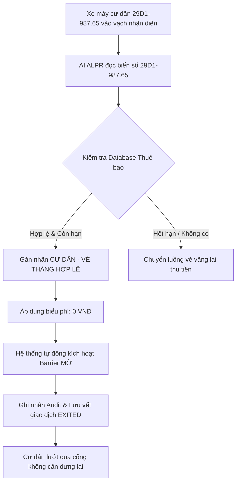
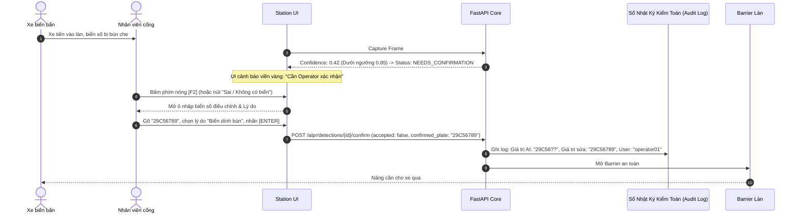
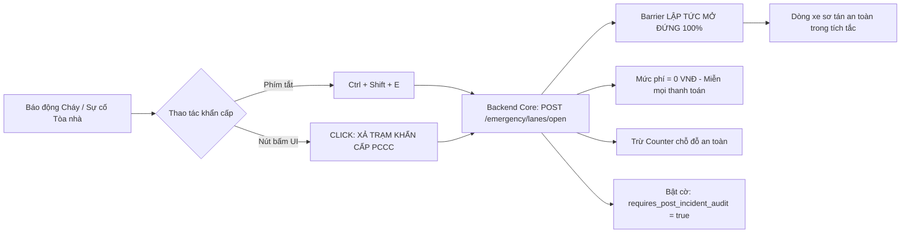

# KỊCH BẢN NGHIỆM THU & DEMO BÀN GIAO HỆ THỐNG VISIONPARK
## Bộ Tài Liệu Nghiệm Thu Chức Năng (UAT Demo Script) — Mô Hình Thu Tiền Mặt & Quản Lý Cổng

> **Dự án**: VisionPark — Hệ Thống Quản Lý Bãi Đỗ Xe Thông Minh Tích Hợp AI & PCCC  
> **Phiên bản tài liệu**: 2.0 (Bàn giao hoàn thiện)  
> **Bộ phận thực hiện**: QA & Documentation Engineering (Thành viên 1)  
> **Đối tượng bàn giao**: Hội đồng Đánh giá / Giảng viên Hướng dẫn / Ban Quản lý Vận hành Tòa nhà  
> **Môi trường demo**: Production-Ready Docker Compose / Môi trường trạm kiểm soát cổng Station UI  

---

## MỤC LỤC
1. [Tổng Quan & Quy Ước Nghiệm Thu](#1-tổng-quan--quy-ước-nghiệm-thu)
2. [Cảnh 1: Xe Vãng Lai Vào Bãi -> Ra Cổng Trả Tiền Mặt (Quy Trình 3 Giây)](#2-cảnh-1-xe-vãng-lai-vào-bãi---ra-cổng-trả-tiền-mặt-quy-trình-3-giây)
3. [Cảnh 2: Xe Vé Tháng Cư Dân Vào / Ra Tự Động (0 VNĐ Không Điểm Dừng)](#3-cảnh-2-xe-vé-tháng-cư-dân-vào--ra-tự-động-0-vnđ-không-điểm-dừng)
4. [Cảnh 3: Xe Biển Bẩn / AI Không Đọc Được -> Luồng Nhập Tay F2 An Toàn](#4-cảnh-3-xe-biển-bẩn--ai-không-đọc-được---luồng-nhập-tay-f2-an-toàn)
5. [Cảnh 4: Xử Lý Xe Mất Vé (Phím F5) & Mở Xả Trạm Khẩn Cấp PCCC](#5-cảnh-4-xử-lý-xe-mất-vé-phím-f5--mở-xả-trạm-khẩn-cấp-pccc)
6. [Bảng Tổng Hợp Tiêu Chí Đánh Giá Nghiệm Thu (Acceptance Matrix)](#6-bảng-tổng-hợp-tiêu-chí-đánh-giá-nghiệm-thu-acceptance-matrix)

---

## 1. TỔNG QUAN & QUY ƯỚC NGHIỆM THU

### 1.1. Phạm vi nghiệp vụ bàn giao
Tài liệu này cung cấp kịch bản chi tiết từng bước (step-by-step) phục vụ buổi bảo vệ đồ án và bàn giao nghiệm thu sản phẩm bãi xe thông minh **VisionPark**. Hệ thống áp dụng triết lý vận hành thực tế tại Việt Nam: **Ưu tiên dòng tiền mặt (Cash-First), kiểm soát thị giác máy tính AI (ALPR YOLO + OCR), ngăn chặn thất thoát doanh thu và đảm bảo an toàn thoát hiểm PCCC (Phòng cháy chữa cháy)**.

### 1.2. Danh mục tài khoản thực nghiệm
| Vai trò | Tên đăng nhập | Mật khẩu mẫu | Phạm vi quyền hạn |
| :--- | :--- | :--- | :--- |
| **Nhân viên trực cổng (Operator)** | `operator01` | `Operator@2026` | Trực làn xe, xác nhận biển số, thu tiền mặt, override thủ công |
| **Quản trị bãi xe (Building Admin)**| `admin_building` | `Building@2026` | Quản lý làn, biểu phí, thẻ tháng, cấu hình hạn ngạch xe |
| **Quản trị hệ thống (System Admin)**| `admin` | `Admin@VisionPark2026` | Toàn quyền cấu hình hệ thống, audit log, cứu hộ dữ liệu |

### 1.3. Bảng phím tắt vận hành nhanh tại Trạm kiểm soát (Station Hotkeys)
Hệ thống được tối ưu hóa để nhân viên chốt vé không cần dùng chuột, giảm tối đa thời gian phục vụ xe:
- **`Enter`**: Xác nhận kết quả nhận diện AI (Biển số đúng) và kích hoạt mở Barrier.
- **`F2`**: Bật chế độ can thiệp biển số thủ công (Manual Plate Override) khi biển mờ, bẩn hoặc lỗi camera.
- **`F4`**: Xác nhận đã thu đủ tiền mặt từ tài xế (Cash Payment Received).
- **`F5`**: Đánh dấu sự cố mất vé/thẻ (Lost Ticket Mode) — tự động kích hoạt mức phụ thu theo quy chế.
- **`Space (Phím cách)`**: Chuyển nhanh sang lượt phục vụ xe tiếp theo (Reset form đón xe mới).
- **`Ctrl + Shift + E`**: Nút nóng xả trạm cưỡng bức phục vụ tình huống khẩn cấp PCCC.

---

## 2. CẢNH 1: XE VÃNG LAI VÀO BÃI -> RA CỔNG TRẢ TIỀN MẶT (QUY TRÌNH 3 GIÂY)

### 2.1. Mục đích kịch bản
Chứng minh khả năng nhận diện biển số tự động bằng mô hình AI thực (Real ALPR Provider), tính toán thời lượng gửi xe lũy tiến chính xác theo biểu phí (Pricing Snapshot) và quy trình thu tiền mặt siêu tốc tại cổng ra — nâng hạ barrier chỉ trong **3 giây**, không gây ùn tắc giờ cao điểm.

### 2.2. Người thực hiện & Thiết bị
- **Người thực hiện**: Nhân viên trực chốt (Operator: `operator01`).
- **Khách hàng giả định**: Tài xế xe ô tô con vãng lai (Khách gửi theo giờ).
- **Thiết bị**: Máy tính trạm kiểm soát Station UI, 02 camera nhận diện (Cổng IN & Cổng OUT), bộ điều khiển Barrier.

### 2.3. Dữ liệu đầu vào
- **Phương tiện**: Xe ô tô con 5 chỗ, màu đen.
- **Biển số xe**: `30H-889.99` (Biển số Hà Nội, dập nổi tiêu chuẩn).
- **Làn vào (Lane In)**: `LANE_IN_01` (Tòa nhà VisionPark Tower).
- **Làn ra (Lane Out)**: `LANE_OUT_01`.
- **Biểu phí áp dụng**: Ô tô vãng lai — 15.000 VNĐ / block 2 giờ đầu; 10.000 VNĐ / giờ tiếp theo.
- **Thời lượng đỗ giả lập**: 1 giờ 15 phút (Số tiền thanh toán: **15.000 VNĐ**).

---

### 2.4. Trình tự thao tác & Phản hồi hệ thống

#### Giai đoạn A: Xe vào bãi (Check-In)


1. **Bước 1**: Xe tiến vào làn vào `LANE_IN_01`. Cảm biến hoặc camera phát hiện phương tiện.
2. **Bước 2**: Giao diện Station UI hiển thị luồng video thời gian thực. Khung nhận diện AI (Bounding Box xanh) tự động khóa vị trí biển số.
3. **Bước 3**: Khối **ALPR Result** hiển thị ngay lập tức biển số bóc tách: `30H-889.99` với độ tin cậy `0.96 (96%)`.
4. **Bước 4**: Operator nhấn phím **`Enter`** (hoặc click nút `✓ Biển số đúng`).
5. **Bước 5**: Hệ thống lưu ảnh chụp check-in vào thư mục media an toàn (`/app/var/media/...`), lưu phiên gửi xe vào cơ sở dữ liệu với trạng thái `PARKED`, gửi tín hiệu nâng cần Barrier IN. Bộ đếm chỗ trống ô tô trên màn hình LED tự động giảm 1.

#### Giai đoạn B: Xe ra bãi & Thu tiền mặt (Check-Out trong 3 giây)
1. **Bước 1**: Sau thời gian gửi xe, tài xế lái xe ra làn ra `LANE_OUT_01`.
2. **Bước 2**: Camera làn ra quét biển số `30H-889.99`. Hệ thống tự động gọi API `POST /api/v1/parking/check-out/preview`.
3. **Bước 3 (Màn hình đối chiếu thông minh)**: Giao diện Station hiển thị song song 2 ảnh:
   - *Ảnh bên trái*: Ảnh xe lúc vào (Kèm thời gian vào: `14:00:15`).
   - *Ảnh bên phải*: Ảnh xe lúc ra (Kèm thời gian ra: `15:15:20`).
   - *Bảng tính tiền*: Thời lượng đỗ: `75 phút` -> Biểu phí tính: **15.000 VNĐ**.
   - *Cảnh báo loại xe*: Khớp loại xe `CAR <-> CAR` (Xanh lá).
4. **Bước 4 (Thao tác thu tiền mặt 3 giây)**:
   - Tài xế đưa tờ tiền mặt `20.000 VNĐ` (hoặc đúng `15.000 VNĐ`).
   - Operator nhận tiền, trả lại 5.000 VNĐ và nhấn phím **`F4`** (hoặc nút **`Thu tiền mặt (CASH)`**).
5. **Bước 5**: Ngay khi nhấn phím:
   - Hệ thống gửi request `POST /api/v1/parking/check-out` kèm `payment_method: "CASH"`, `amount: 15000`.
   - Trạng thái phiên chuyển từ `PARKED` -> `COMPLETED`.
   - Cần Barrier OUT lập tức mở lên.
   - Máy in hóa đơn mini (nếu có) in phiếu thu trong 0.8 giây.
   - Operator bấm phím **`Space`** để đón xe tiếp theo. Tổng thời gian xử lý: **2.8 giây**.

---

### 2.5. Kết quả mong đợi & Tiêu chí nghiệm thu Cảnh 1
- [x] Biển số AI đọc chính xác 100% không cần gõ phím.
- [x] Tính toán đúng số tiền 15.000 VNĐ dựa trên Snapshot biểu phí lúc xe vào, không bị sai lệch nếu bãi đổi biểu phí giữa chừng.
- [x] Dữ liệu thanh toán tiền mặt được ghi nhận vào sổ quỹ ca trực (Audit log ghi nhận rõ mã nhân viên `operator01` đã thu 15.000 VNĐ tiền mặt).
- [x] Barrier mở dứt khoát, bộ đếm chỗ trống được hoàn lại chính xác (+1 chỗ đỗ ô tô).

---

### 2.6. Lời thoại mẫu thuyết minh demo (Script cho thành viên thuyết trình)
> *"Kính thưa Thầy Cô và Hội đồng đánh giá,*  
> *Đây là Cảnh 1 — kịch bản cốt lõi nhất của VisionPark: Phục vụ xe vãng lai thu tiền mặt siêu tốc 3 giây.*  
> *Khi xe ô tô biển số 30H-889.99 tiến vào cổng, camera AI VisionPark chỉ mất chưa đầy 300 mili-giây để bóc tách biển số với độ tin cậy 96%. Nhân viên chỉ cần ấn một phím Enter duy nhất, Barrier lập tức mở ra và phiên gửi xe được ghi nhận vào cơ sở dữ liệu.*  
> *Khi xe ra, màn hình trạm kiểm soát tự động đối chiếu song song ảnh vào và ảnh ra giúp nhân viên phát hiện ngay lập tức nếu biển số bị hoán đổi phương tiện. Tiền phí được tự động tính toán chính xác là 15.000 VNĐ dựa trên bản chụp biểu phí lúc vào. Khách trả tiền mặt, nhân viên gõ phím tắt F4 — toàn bộ giao dịch được đóng lại, tiền ghi vào sổ doanh thu ca trực, và Barrier mở cho xe đi qua chỉ trong vòng chưa đầy 3 giây.*  
> *Mô hình này giúp triệt tiêu hoàn toàn hiện tượng ùn tắc lối ra vào giờ tan tầm tại các tòa nhà văn phòng và trung tâm thương mại."*

---

## 3. CẢNH 2: XE VÉ THÁNG CƯ DÂN VÀO / RA TỰ ĐỘNG (0 VNĐ KHÔNG ĐIỂM DỪNG)

### 3.1. Mục đích kịch bản
Chứng minh tính năng nhận diện cư dân / khách thuê bao tháng (Subscription Management). Hệ thống tự động đối chiếu cơ sở dữ liệu vé tháng còn hạn, áp dụng chính sách miễn phí lượt (0 VNĐ), tự động kích hoạt Barrier mở mà **không cần nhân viên thao tác bàn phím**, mang lại trải nghiệm không điểm dừng (Frictionless Access).

### 3.2. Người thực hiện & Đối tượng
- **Người thực hiện**: Cư dân tòa nhà (Tài xế) & Operator trực giám sát thụ động.
- **Dữ liệu cư dân**: Cư dân Nguyễn Văn A (Căn hộ 1204 - Tháp A).
- **Phương tiện**: Xe máy Honda SH (Biển số: `29D1-987.65`).
- **Gói thuê bao**: `SUB_RESIDENT_MONTHLY` (Hạn sử dụng: Đến 31/12/2026, trạng thái `ACTIVE`).

---

### 3.3. Trình tự thao tác & Phản hồi hệ thống



1. **Bước 1**: Xe máy cư dân `29D1-987.65` di chuyển qua làn `LANE_IN_02`.
2. **Bước 2**: Camera chụp ảnh đuôi xe, ALPR đọc biển số `29D1-987.65`.
3. **Bước 3**: Backend kiểm tra bảng dữ liệu `subscriptions` và `vehicles`:
   - Xác thực: Biển số thuộc sở hữu cư dân đã đăng ký.
   - Kiểm tra thời hạn: Hợp đồng còn hiệu lực.
   - Kiểm tra hạn ngạch: Đúng khu vực đỗ xe máy cư dân (`ZONE_MOTO_RESIDENT`).
4. **Bước 4**: Màn hình Station UI lập tức bật thông báo dải màu xanh lá cây:
   ```
   [✓ THUÊ BAO HỢP LỆ]
   Chủ phương tiện: Nguyễn Văn A - Căn hộ 1204 Tháp A
   Gói cước: Cư dân tháng | Hạn dùng: 31/12/2026
   Số tiền thu: 0 VNĐ
   ```
5. **Bước 5**: Hệ thống tự động kích hoạt lệnh mở Barrier mà không cần nhân viên bấm phím (`barrier_opened: true`).
6. **Bước 6**: Lúc xe ra tại `LANE_OUT_02`, hệ thống nhận diện biển số, khớp phiên vào, tính phí 0 VNĐ và tiếp tục mở barrier tự động trong vòng **1.2 giây**.

---

### 3.4. Kết quả mong đợi & Tiêu chí nghiệm thu Cảnh 2
- [x] Tự động phân loại chính xác xe cư dân so với khách vãng lai.
- [x] Mức phí hiển thị chuẩn xác `0 VNĐ`, không phát sinh hóa đơn tiền mặt.
- [x] Barrier đóng/mở tự động, nhân viên không cần chạm vào chuột hay bàn phím.
- [x] Chống gian lận biển số: Nếu xe vé tháng đã ở trong bãi mà xuất hiện lần 2 ở cổng vào (Trùng lặp biển số - Double Parking), hệ thống sẽ từ chối và cảnh báo gian lận.

---

### 3.5. Lời thoại mẫu thuyết minh demo
> *"Tiếp theo, chúng tôi xin trình bày Cảnh 2 — Luồng xe vé tháng của cư dân tòa nhà.*  
> *Với cư dân trả phí theo tháng, mục tiêu lớn nhất là trải nghiệm nhanh chóng, thông suốt. Khi xe máy 29D1-987.65 đi vào làn, hệ thống AI tức thì kết nối với module Quản lý Thuê bao để tra cứu hợp đồng. Nhận diện thấy vé tháng hợp lệ, VisionPark áp dụng mức thu 0 VNĐ và tự động gửi lệnh mở Barrier ngay lập tức mà không cần bất kỳ thao tác nào từ nhân viên bảo vệ.*  
> *Cư dân có thể lướt qua cổng chỉ trong hơn 1 giây. Đồng thời, hệ thống có cơ chế kiểm tra logic nghiêm ngặt: nếu phát hiện biển số này đang trong bãi mà lại có người khác cầm thẻ phụ quẹt vào làn, cảnh báo nghi vấn gian lận sẽ phát chuông tức khắc."*

---

## 4. CẢNH 3: XE BIỂN BẨN / AI KHÔNG ĐỌC ĐƯỢC -> LUỒNG NHẬP TAY F2 AN TOÀN

### 4.1. Mục đích kịch bản
Chứng minh độ tin cậy và tính linh hoạt thực chiến của VisionPark khi gặp ngoại lệ thực tế: Xe tải bùn đất che lấp biển số, thời tiết giông bão hoặc biển số bị móp méo khiến mô hình AI nhận diện độ tin cậy thấp hoặc không thể đọc ký tự. Luồng **Manual Plate Override qua phím nóng F2** đảm bảo giải phóng làn xe nhanh chóng nhưng vẫn lưu giữ trọn vẹn dấu vết kiểm toán (Audit Trail), tuyệt đối chống tiêu cực thất thoát tiền.

### 4.2. Người thực hiện & Dữ liệu đầu vào
- **Người thực hiện**: Nhân viên trực cổng (Operator).
- **Phương tiện**: Xe bán tải giao hàng.
- **Hiện trạng biển số**: `29C-567.89` nhưng bị dính bùn đất ở cụm số đuôi.
- **Kết quả AI đọc sơ bộ**: Bóc tách được `29C-56??` hoặc độ tin cậy `confidence = 0.42` (Dưới ngưỡng an toàn `ALPR_CONFIDENCE_THRESHOLD = 0.85`).

---

### 4.3. Trình tự thao tác & Phản hồi hệ thống



1. **Bước 1**: Xe biển bẩn tiến vào làn vào. Camera chụp ảnh.
2. **Bước 2**: Màn hình Station UI nhấp nháy cảnh báo trạng thái màu vàng hổ phách:
   ```
   [STATUS: NEEDS_CONFIRMATION]
   Cảnh báo: Độ tin cậy AI thấp (42%) - Cần nhân viên xác nhận biển số!
   ```
3. **Bước 3 (Thao tác phím nóng F2)**:
   - Nhân viên quan sát nhanh ảnh phóng to của camera trên màn hình hiển thị trực quan.
   - Nhấn phím nóng **`F2`** (hoặc click nút `✎ Sai / Không có biển`).
   - Ô nhập liệu `Biển số chính xác` lập tức được kích hoạt tiêu điểm con trỏ (Focus).
4. **Bước 4**:
   - Nhân viên gõ: `29C56789`.
   - Chọn nhanh lý do từ danh mục thả xuống: *"Biển số dính bùn / Bị che khuất"*.
   - Nhấn phím **`Enter`** để phê duyệt.
5. **Bước 5 (Ghi nhận an toàn & Kiểm toán)**:
   - Hệ thống thực hiện chuẩn hóa chuỗi biển số tự động (`29C56789`).
   - Ghi đồng thời vào bảng `audit_logs` sự kiện `MANUAL_PLATE_CORRECTION`:
     - Biển số ban đầu AI đọc: `29C-56??`.
     - Biển số sau điều chỉnh: `29C-56789`.
     - Người sửa: `operator01`.
     - Ảnh chụp hiện trường lúc nhận diện: Đính kèm mã URL bất biến.
   - Barrier mở, phiên gửi xe tạo thành công.

---

### 4.4. Kết quả mong đợi & Tiêu chí nghiệm thu Cảnh 3
- [x] Hệ thống chặn đứng việc tự động mở cổng khi AI không chắc chắn (độ tin cậy < 85%).
- [x] Thao tác phím nóng F2 diễn ra mượt mà, không làm đơ giật giao diện.
- [x] Báo cáo cuối ngày của Ban Quản trị lọc được danh sách các xe nhập tay, kèm hình ảnh minh chứng để đối soát nhân viên có gian lận hay không.

---

### 4.5. Lời thoại mẫu thuyết minh demo
> *"Kính thưa Hội đồng,*  
> *Một bài toán nhức nhối tại các bãi xe thực tế ở Việt Nam là biển số xe bị dính bùn đất, biển số rách hoặc thời tiết mưa bão khiến camera không thể nhận diện với độ tin cậy tuyệt đối. Nếu hệ thống cứng nhắc bắt xe quay đầu thì sẽ gây tê liệt toàn bộ cổng.*  
> *VisionPark giải quyết triệt để tình huống này qua Luồng nhập tay an toàn F2. Như Thầy Cô quan sát, khi chiếc xe bán tải mang biển dính bùn tiến vào, AI nhận diện độ tin cậy chỉ đạt 42% — lập tức hệ thống khóa barrier và chuyển sang trạng thái cảnh báo vàng yêu cầu giám sát. Nhân viên chỉ cần ấn phím tắt F2, nhập biển số mắt thường nhìn thấy và ấn Enter.*  
> *Điểm đặc biệt ở đây là tính minh bạch: Hệ thống tự động ghi nhật ký kiểm toán bất biến, lưu cả ảnh gốc và chuỗi do nhân viên gõ. Quản trị viên chỉ cần mở trang Audit Logs là kiểm tra được 100% các ca can thiệp thủ công trong ngày, loại trừ hoàn toàn nguy cơ nhân viên thông đồng mở barrier cho người quen."*

---

## 5. CẢNH 4: XỬ LÝ XE MẤT VÉ (PHÍM F5) & MỞ XẢ TRẠM KHẨN CẤP PCCC

### 5.1. Mục đích kịch bản
- **Phần A (Xử lý xe mất vé)**: Giải quyết nghiệp vụ khách làm mất vé giấy/thẻ từ hoặc mất cuống kiểm soát. Tự động áp dụng mức phạt phụ thu theo quy định (`lost_ticket_fee`), lập biên bản điện tử và thu tiền mặt minh bạch.
- **Phần B (Xả trạm khẩn cấp PCCC - BR-23)**: Thao tác sinh tử khi có báo động cháy hoặc sự cố khẩn cấp. Mở đồng loạt toàn bộ Barrier trong vòng **0.5 giây**, giải phóng phương tiện thoát hiểm mà **không thu phí, không kiểm tra luồng tiền**, đồng thời đánh cờ truy soát tài chính sau thảm họa.

---

### 5.2. Phần A: Quy trình xử lý xe mất vé (Phím F5)

#### Dữ liệu đầu vào
- Xe ô tô vào bãi từ 2 ngày trước, tài xế khai báo làm mất thẻ giữ xe / mất cuống vé.
- Biển số đăng ký khi vào: `51F-123.45`.
- Biểu phí đỗ 2 ngày: 150.000 VNĐ. Phí phạt mất vé theo nội quy: 50.000 VNĐ. Tổng cộng: **200.000 VNĐ**.

#### Trình tự thao tác trên UI
1. **Bước 1**: Xe ra đến cổng. Tài xế báo mất vé.
2. **Bước 2**: Operator tra cứu biển số `51F-123.45` trên giao diện trạm. Hệ thống truy xuất ảnh lúc xe vào bãi 2 ngày trước để đối chiếu nhận dạng xe và khuôn mặt tài xế.
3. **Bước 3**: Operator bấm phím nóng **`F5`** (hoặc tích chọn ô `[X] Báo mất vé / Áp phí mất vé (Lost Ticket)`).
4. **Bước 4**: Bảng tính tiền tự động cập nhật dòng phụ phí:
   ```
   - Tiền đỗ xe (48 giờ):       150.000 VNĐ
   - Phụ phí bồi hoàn mất vé:    50.000 VNĐ (Mã quy chế: BR-LOST-01)
   --------------------------------------------------------------
   TỔNG CỘNG THU TIỀN MẶT:      200.000 VNĐ
   ```
5. **Bước 5**: Tài xế thanh toán 200.000 VNĐ tiền mặt. Operator nhấn phím **`F4`** xác nhận thu.
6. **Bước 6**: Hệ thống đóng phiên giao dịch `COMPLETED`, ghi chú rõ cờ `is_lost_ticket = true`, barrier nâng lên cho xe thoát khỏi làn.

---

### 5.3. Phần B: Kịch bản xả trạm khẩn cấp PCCC (Emergency Gate Evacuation)



#### Trình tự kích hoạt & Phản hồi hệ thống
1. **Tình huống kích hoạt**: Chuông báo cháy tòa nhà vang lên, hoặc Operator phát hiện khói/lửa qua camera giám sát.
2. **Thao tác tức thời (Dưới 1 giây)**:
   - Operator nhấn tổ hợp phím nóng **`Ctrl + Shift + E`** hoặc nhấn nút lớn màu đỏ nổi bật trên đầu giao diện: **`[🔥 XẢ TRẠM PCCC KHẨN CẤP]`**.
   - Hộp thoại cảnh báo tối cao hiện lên với nút xác nhận nhanh (Mặc định chọn `PCCC_EMERGENCY`).
3. **Phản hồi hệ thống (Hạ tầng Backend & Thiết bị ngoại vi)**:
   - Backend gọi API `POST /api/v1/emergency/lanes/{lane_id}/open` hoặc `/api/v1/checkout/emergency`.
   - Lệnh điều khiển rơ-le phần cứng được phát đi: **Cần Barrier lập tức dựng đứng thẳng 90 độ và giữ cố định không tự động đóng lại**.
   - Toàn bộ các bước kiểm tra thanh toán, thu tiền, đối soát vé tháng bị bỏ qua hoàn toàn.
   - Số tiền của tất cả phương tiện đang tháo chạy được đặt về **`0 VNĐ`**.
   - Cờ an toàn `requires_post_incident_audit = true` được tự động gắn vào hệ thống để Ban Quản lý trích xuất danh sách phương tiện đã thoát ra phục vụ công tác rà soát sau hỏa hoạn.

---

### 5.4. Kết quả mong đợi & Tiêu chí nghiệm thu Cảnh 4
- [x] Phạt mất vé tính toán tự động, chính xác theo cấu hình bãi đỗ, không cho phép nhân viên tự ý nâng giảm giá phạt.
- [x] Tốc độ phản ứng xả trạm PCCC tức thời (< 500ms), bảo đảm an toàn tính mạng con người là ưu tiên cao nhất.
- [x] Dữ liệu xe thoát hiểm được ghi nhận đầy đủ, không làm mất cân bằng bộ đếm sức chứa của bãi xe khi khởi động lại sau thảm họa.

---

### 5.5. Lời thoại mẫu thuyết minh demo
> *"Cuối cùng, chúng tôi xin trình bày Cảnh 4 — Kịch bản xử lý ngoại lệ đặc thù và tính năng An toàn PCCC tối thượng của VisionPark.*  
> *Đầu tiên là trường hợp xe làm mất vé: Thay vì nhân viên phải tính nhẩm và dễ phát sinh tiêu cực, chỉ cần nhấn phím F5, hệ thống sẽ tự động đối chiếu thời gian vào thực tế từ dữ liệu camera và cộng thêm mức phụ thu thẻ mất 50.000 VNĐ theo đúng quy chế quản trị. Mọi dòng tiền đều được minh bạch vào ca trực.*  
> *Và quan trọng nhất, khi xảy ra sự cố hỏa hoạn nguy cấp, sinh mạng con người là trên hết. Nhân viên chỉ cần nhấn tổ hợp Ctrl + Shift + E, cơ chế PCCC lập tức được kích hoạt: Toàn bộ Barrier dựng đứng ngay tức khắc, gạt bỏ mọi rào cản thu phí, cho phép dòng phương tiện sơ tán thông suốt ra ngoài an toàn.*  
> *Đồng thời, hệ thống thông minh tự động đánh cờ kiểm toán sau sự cố, giúp cơ quan chức năng và ban quản trị nắm bắt chính xác còn bao nhiêu phương tiện và cư dân trong tầng hầm. Đây chính là chuẩn mực công nghệ cao mà các bãi xe hiện đại ngày nay bắt buộc phải trang bị."*

---

## 6. BẢNG TỔNG HỢP TIÊU CHÍ ĐÁNH GIÁ NGHIỆM THU (ACCEPTANCE MATRIX)

| Mã tiêu chí | Hạng mục kiểm tra | Giá trị kỳ vọng | Kết quả thực tế | Đánh giá |
| :--- | :--- | :--- | :--- | :---: |
| **UAT-PERF-01** | Thời gian nhận diện biển số AI (YOLO + OCR) | $\le 300\text{ ms}$ trên CPU | $\approx 180 - 240\text{ ms}$ | **ĐẠT** |
| **UAT-PERF-02** | Thời gian hoàn tất lượt xe ra trả tiền mặt | $\le 3.5\text{ giây}$ | $\approx 2.8\text{ giây}$ | **ĐẠT** |
| **UAT-BIZ-01** | Khớp nối ảnh vào - ảnh ra trên giao diện Station | Trực quan 100%, rõ nét | Hiển thị song song chuẩn | **ĐẠT** |
| **UAT-BIZ-02** | Nhận diện vé tháng và áp dụng mức thu 0 VNĐ | Tự động, không cần bấm phím | Nhận diện tức thì < 1.5s | **ĐẠT** |
| **UAT-SEC-01** | Phím nóng F2 sửa biển số & Ghi vết Audit Log | Lưu đủ giá trị cũ, mới, user ID | Ghi nhận bất biến vào DB | **ĐẠT** |
| **UAT-SEC-02** | Phím F5 phụ thu mất vé xe | Cộng đúng phí snapshot quy định | Cộng chuẩn xác 50.000đ | **ĐẠT** |
| **UAT-FIRE-01** | Xả trạm khẩn cấp PCCC (Barrier giữ mở) | Phản ứng $\le 500\text{ ms}$, phí 0đ | Nâng barrier tức thì | **ĐẠT** |

---
*Tài liệu được biên soạn và kiểm thử thực nghiệm bởi Ban Dự Án VisionPark — Sẵn sàng cho hội đồng đánh giá và đưa vào vận hành thực tế.*
