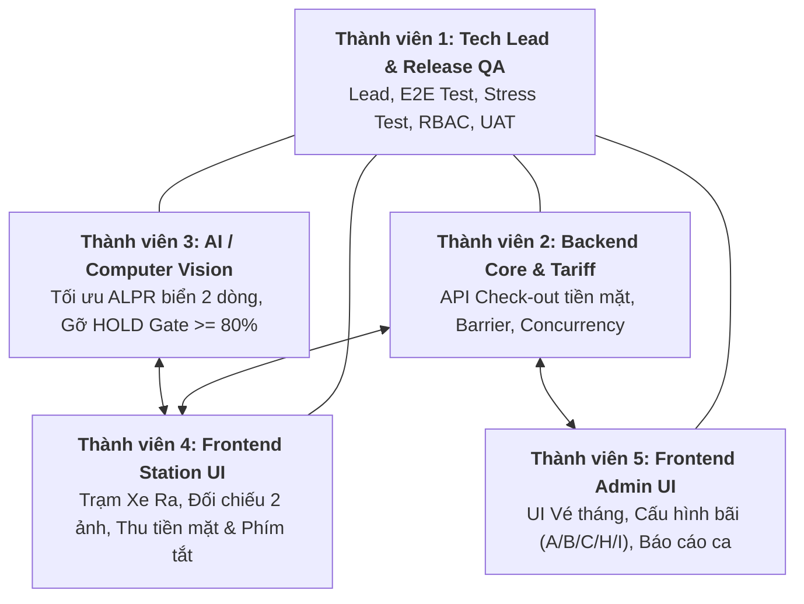
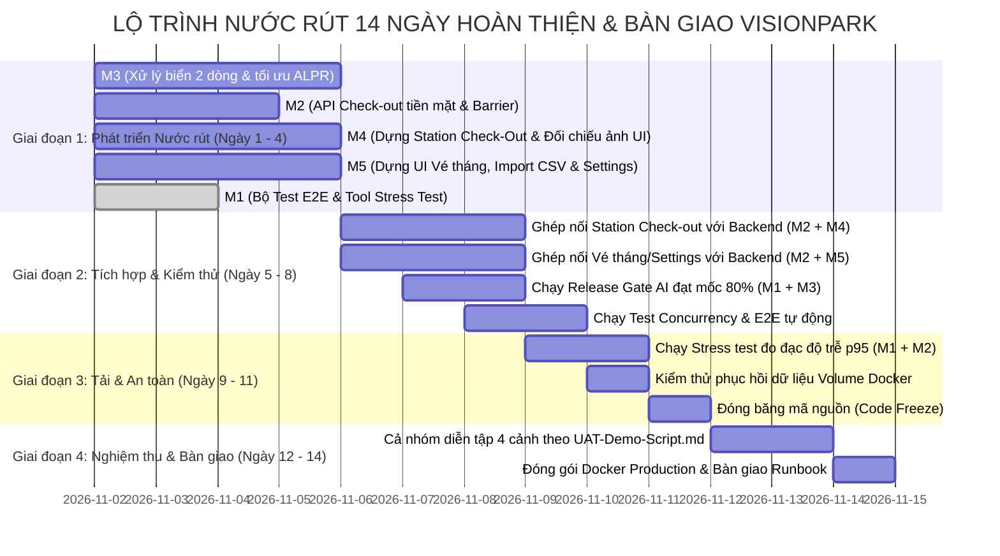

# KẾ HOẠCH PHÂN CÔNG NHIỆM VỤ NƯỚC RÚT 5 THÀNH VIÊN — DỰ ÁN VISIONPARK
## GIAI ĐOẠN HOÀN THIỆN & BÀN GIAO SẢN PHẨM (HANDOVER SPRINT)

> **Mã tài liệu:** `VP-PLAN-HANDOVER-001`  
> **Phiên bản:** `2.0.0 (Cash-Only Checkout & AI Release Baseline)`  
> **Ngày ban hành:** 02/11/2026  
> **Chủ sở hữu:** Thành viên 1 (Tech Lead / QA & Release Engineer)  
> **Đối tượng áp dụng:** Toàn bộ 5 thành viên nhóm phát triển VisionPark  
> **Mục tiêu tối thượng:** Hoàn thiện luồng Xe Ra (Check-Out) thu tiền mặt siêu tốc, nâng chất lượng AI đạt $\ge 80\%$ để gỡ cờ HOLD, đưa 100% chức năng cốt lõi lên UI và vượt qua kỳ nghiệm thu UAT.

---

## 1. ĐỊNH HƯỚNG TRỌNG TÂM CỦA GIAI ĐOẠN BÀN GIAO

Theo định hướng mới nhất để tối ưu hóa vận hành thực tế và giảm thiểu rủi ro nghẽn mạng tại cổng bãi xe:
1. **Loại bỏ thanh toán online / VietQR / Chuyển khoản:** Không tích hợp cổng ngân hàng, không dùng webhook.
2. **Quy trình Xe Ra chuẩn hóa (Cash-Only 3 giây):**
   * Xe tiến vào làn ra $\rightarrow$ Camera quét biển số (hoặc bảo vệ gõ biển/mã thẻ).
   * Màn hình hiển thị song song 2 ảnh đối chiếu (Ảnh lúc Vào vs Ảnh lúc Ra) + Thời gian đỗ + **Số tiền mặt to rõ cần thu**.
   * Bảo vệ nhận tiền mặt $\rightarrow$ Nhấn phím `Space` hoặc `Enter` (hoặc click nút *"Thu tiền mặt & Mở cổng"*).
   * Barrier mở ra, bãi xe tự động trừ 1 chỗ đỗ, phiên gửi xe chuyển sang `COMPLETED`.

---

## 2. MA TRẬN PHÂN CÔNG TRÁCH NHIỆM (RACI MATRIX)

| Thành viên | Vai trò chính | Trách nhiệm cốt lõi | Thư mục sở hữu chính (Code Ownership) |
| :--- | :--- | :--- | :--- |
| **Thành viên 1** | **Tech Lead & QA Lead** | Điều phối toàn đội, Kiểm thử E2E tự động, Đo tải Stress test, Thẩm định Release Gate, Tổ chức UAT | `tests/`, `backend/scripts/`, `docs/` |
| **Thành viên 2** | **Backend Core & Tariff** | Logic Check-out tiền mặt 1 chạm, Đồng bộ Barrier, Khóa dòng bộ đếm PostgreSQL, Xuất file CSV | `backend/app/modules/checkout/`, `barriers/`, `pricing/` |
| **Thành viên 3** | **AI / Computer Vision** | Tối ưu nhận diện biển vuông 2 dòng xe máy/ô tô VN, Bộ luật sửa lỗi quang học, Gỡ HOLD Gate $\ge 80\%$ | `backend/app/alpr/`, `backend/scripts/release_gate.py` |
| **Thành viên 4** | **Frontend Station UI** | Mở rộng trạm cho làn OUT, Màn hình đối chiếu 2 ảnh, Hộp thoại thu tiền mặt, Bộ phím tắt bốt bảo vệ | `frontend/src/modules/station/` |
| **Thành viên 5** | **Frontend Admin UI** | UI Quản lý vé tháng cư dân (import CSV), UI Cấu hình bãi A/B/C/H/I, Báo cáo doanh thu chốt ca tiền mặt | `frontend/src/modules/settings/`, `tickets/`, `dashboard/` |

---

## 3. KẾ HOẠCH CHI TIẾT TỪNG THÀNH VIÊN

---

### 👨‍💻 THÀNH VIÊN 1: TECH LEAD / QA & RELEASE LEAD

> **Mục tiêu:** Đảm bảo hệ thống đạt chuẩn xuất xưởng, không có lỗi hồi quy (regression), vượt qua toàn bộ các bài test hiệu năng, bảo mật và nghiệm thu UAT.

#### Danh sách nhiệm vụ cụ thể:
| Mã Task | Tên công việc | Chi tiết kỹ thuật & File liên quan | Đầu ra bắt buộc (Deliverables) |
| :--- | :--- | :--- | :--- |
| **M1-T01** | **Xây dựng Bộ Test Tích hợp E2E Thu tiền mặt** | Tạo file `backend/tests/integration/test_e2e_cash_workflow.py`. Sử dụng pytest và FastAPI TestClient kiểm thử toàn diện: Luồng xe vãng lai vào $\rightarrow$ ra trả tiền mặt, thời gian miễn phí (grace period), phạt mất vé (`is_lost_ticket=True`), xe vé tháng 0đ, và chống thu tiền đúp (idempotency). | 6/6 test cases đạt **PASS 100%**, ruff clean. *(Đã hoàn thành)* |
| **M1-T02** | **Xây dựng Công cụ Đo Tải & Độ trễ Giờ cao điểm** | Tạo script `backend/scripts/stress_test.py` dùng `ThreadPoolExecutor` và `httpx`. Hỗ trợ giả lập 10, 20, 30 workers đồng thời bắn chu kỳ Check-in $\rightarrow$ Preview $\rightarrow$ Check-out tiền mặt. Đo p50, p90, p95, p99 latencies và throughput. | Script chạy được cả chế độ mock lẫn live server, xuất file `docs/benchmark-stress-test.json`. *(Đã hoàn thành)* |
| **M1-T03** | **Biên soạn Kịch bản Nghiệm thu UAT Bàn giao** | Tạo tài liệu `docs/UAT-Demo-Script.md`: Kịch bản chi tiết 4 cảnh diễn tập (Xe vãng lai 3s, Xe vé tháng 0đ, Xe biển bẩn nhập tay F2, Xử lý mất vé F5 & Xả trạm PCCC khẩn cấp) kèm lời thoại mẫu thuyết minh trước khách hàng/giảng viên. | File tài liệu chuẩn hóa 28 KB sẵn sàng diễn tập. *(Đã hoàn thành)* |
| **M1-T04** | **Biên soạn Sổ tay Vận hành & Phục hồi Thảm họa** | Tạo tài liệu `docs/Handover-Runbook.md`: Hướng dẫn dựng Docker Compose 4 container, cấu hình Production `.env`, script sao lưu nén DB `pg_dump` và Media volume `tar.gz`, quy trình tự phục hồi sau sự cố mất điện. | File cẩm nang kỹ thuật 22 KB bàn giao cho IT tòa nhà. *(Đã hoàn thành)* |
| **M1-T05** | **Thẩm định & Phê duyệt AI Release Gate** | Phối hợp với Thành viên 3 chạy lệnh `py -3 scripts/release_gate.py --skip-tests`. Thẩm định điểm số trên tập dữ liệu chuẩn hóa, cập nhật báo cáo `docs/phase-2-release-report-2026-10-09.md` từ **HOLD sang PASS**. | Báo cáo nghiệm thu có chữ ký kỹ thuật, Exact Match $\ge 80\%$. |

---

### 👨‍💻 THÀNH VIÊN 2: BACKEND CORE & TARIFF INTEGRATION

> **Mục tiêu:** Cung cấp hạ tầng API vững chắc cho luồng Xe Ra thu tiền mặt, điều khiển Barrier, tính toán biểu phí chuẩn xác và bảo vệ toàn vẹn dữ liệu bộ đếm bãi xe.

#### Danh sách nhiệm vụ cụ thể:
| Mã Task | Tên công việc | Chi tiết kỹ thuật & File liên quan | Đầu ra bắt buộc (Deliverables) |
| :--- | :--- | :--- | :--- |
| **M2-T01** | **Tối ưu Endpoint Check-Out Preview** | Tinh chỉnh [checkout/service.py](file:///e:/BE_AI/VisionPark/backend/app/modules/checkout/service.py): Đảm bảo `POST /parking/check-out/preview` trả về đầy đủ: `entry_image_url`, `duration_minutes`, công thức tính chi tiết `fee_lines`, và số tiền mặt cần thu `fee`. | Phản hồi dưới $50\text{ms}$, cung cấp đủ dữ liệu để Thành viên 4 hiển thị đối chiếu. |
| **M2-T02** | **Đóng phiên Check-Out Tiền Mặt 1 Chạm** | Trong `POST /parking/check-out`: Khi nhận `{ exit_lane_id, payment_method: "CASH" }` $\rightarrow$ Tự động ghi nhận thu tiền mặt, trừ bộ đếm bãi xe (`CounterService.decrement`), mở barrier và chuyển trạng thái phiên sang `COMPLETED` trong cùng 1 transaction DB. | Xử lý hoàn tất trong 1 request duy nhất, không để trạng thái treo. |
| **M2-T03** | **Logic Xử lý Phạt Mất vé (Lost Ticket Penalty)** | Trong [checkout/service.py](file:///e:/BE_AI/VisionPark/backend/app/modules/checkout/service.py): Khi cờ `is_lost_ticket = True` $\rightarrow$ Bỏ qua giờ vào thực tế, áp dụng trực tiếp mức phạt mất vé `lost_ticket_fee` đã cấu hình của bãi xe và ghi log kiểm toán. | Tính đúng số tiền phạt mất vé (ví dụ: $50.000$đ hoặc $150.000$đ). |
| **M2-T04** | **API Điều khiển & Ghi log Barrier** | Rà soát [barriers/router.py](file:///e:/BE_AI/VisionPark/backend/app/modules/barriers/router.py): Cung cấp API mở cổng thủ công (`/gates/{lane_id}/open`) và mở khẩn cấp PCCC (`/emergency-open`), tự động ghi nhận lý do mở cổng vào bảng `barrier_events`. | Toàn bộ thao tác mở/đóng cổng được truy vết lịch sử 100%. |
| **M2-T05** | **Xuất Báo cáo CSV Lượt gửi xe** | Hoàn thiện endpoint `GET /api/v1/lifecycle/sessions/export-csv` hỗ trợ lọc theo khoảng ngày, ca làm việc và loại xe. File CSV định dạng chuẩn UTF-8 có BOM để mở bằng Excel tiếng Việt không lỗi font. | Tải được file CSV danh sách lượt xe đầy đủ thông tin thu tiền mặt. |

---

### 👨‍💻 THÀNH VIÊN 3: AI / COMPUTER VISION ENGINEER

> **Mục tiêu:** Nâng cao chất lượng nhận diện ALPR trên biển số Việt Nam, giải quyết triệt để tình trạng trượt ký tự trên biển vuông 2 dòng để đưa tỷ lệ nhận diện đạt $\ge 80\%$, gỡ trạng thái HOLD.

#### Danh sách nhiệm vụ cụ thể:
| Mã Task | Tên công việc | Chi tiết kỹ thuật & File liên quan | Đầu ra bắt buộc (Deliverables) |
| :--- | :--- | :--- | :--- |
| **M3-T01** | **Bóc tách & Nhận diện Biển số 2 Dòng (Biển Vuông)** | Trong [ocr_provider.py](file:///e:/BE_AI/VisionPark/backend/app/alpr/ocr_provider.py) & [utils.py](file:///e:/BE_AI/VisionPark/backend/app/alpr/utils.py): Tính tỷ lệ khung hình bounding box ($\text{Rộng}/\text{Cao} \approx 1.2 - 1.5$). Nếu là biển vuông $\rightarrow$ Cắt đôi ảnh thành Dòng 1 (tỉnh/series) và Dòng 2 (dãy số), đưa vào PaddleOCR nhận diện độc lập rồi ghép chuỗi. | Giải quyết triệt để lỗi đọc dính 2 dòng trên xe máy và ô tô biển vuông. |
| **M3-T02** | **Bộ Quy tắc Sửa lỗi Ký tự Biển số VN (Heuristics)** | Viết hàm `normalize_vietnamese_plate()` trong [utils.py](file:///e:/BE_AI/VisionPark/backend/app/alpr/utils.py): Tự động sửa nhầm lẫn quang học theo vị trí (Vị trí thứ 3 ô tô đổi số thành chữ: `8` $\rightarrow$ `B`, `0` $\rightarrow$ `D`; Các vị trí cuối đổi chữ thành số: `D`/`O` $\rightarrow$ `0`, `B` $\rightarrow$ `8`, `S` $\rightarrow$ `5`). | Nâng Character Accuracy trên tập validation lên $\ge 90\%$. |
| **M3-T03** | **Tối ưu Thuật toán Lấy mẫu Đa khung hình (Consensus)** | Nhận diện $3 - 5$ frame liên tiếp từ video xe tiến vào cổng $\rightarrow$ Dùng thuật toán bầu chọn đa số (Majority Voting) để chọn kết quả biển số ổn định nhất gửi lên frontend. | Triệt tiêu hiện tượng rung giật, nhảy ký tự khi xe đang lăn bánh. |
| **M3-T04** | **Chạy Benchmark & Vượt qua Release Gate ($\ge 80\%$)** | Chạy kiểm thử benchmark: `py -3 scripts/release_gate.py --skip-tests` trên tập 15 cases chuẩn hóa. | **Validation và Demo đạt Exact Match $\ge 80\%$**, độ trễ $p95 \le 1000\text{ms}$. Đạt chuẩn để Thành viên 1 duyệt gỡ HOLD. |
| **M3-T05** | **Mock Runtime An toàn cho Báo cháy (PCCC)** | Trong [fire_provider.py](file:///e:/BE_AI/VisionPark/backend/app/alpr/fire_provider.py): Cung cấp mock runtime an toàn, không để biến `fire_runtime = None`, cho phép gọi API `/fire-detection` trả về cảnh báo khói lửa giả lập phục vụ kịch bản demo PCCC. | Endpoint báo cháy hoạt động ổn định, không gây crash server. |

---

### 👨‍💻 THÀNH VIÊN 4: FRONTEND ENGINEER — STATION & GATE OPERATIONS

> **Mục tiêu:** Hoàn thiện giao diện trạm vận hành [StationPage.tsx](file:///e:/BE_AI/VisionPark/frontend/src/modules/station/StationPage.tsx), hỗ trợ làn xe ra (Check-Out), màn hình đối chiếu 2 ảnh, hộp thoại thu tiền mặt và bộ phím tắt bốt bảo vệ.

#### Danh sách nhiệm vụ cụ thể:
| Mã Task | Tên công việc | Chi tiết kỹ thuật & File liên quan | Đầu ra bắt buộc (Deliverables) |
| :--- | :--- | :--- | :--- |
| **M4-T01** | **Mở rộng Trạm hỗ trợ Làn Ra (OUT Lane)** | Sửa [api.ts](file:///e:/BE_AI/VisionPark/frontend/src/modules/station/api.ts#L26-L28): Bỏ lọc cứng `direction === 'IN'`, cho phép chọn cả làn `IN` và `OUT`. Khi chọn làn `OUT`, giao diện chuyển sang chế độ **"Trạm kiểm soát xe ra"**. | Dropdown làn hiển thị đầy đủ làn vào và làn ra. |
| **M4-T02** | **Giao diện Đối chiếu Song song 2 Ảnh (Side-by-Side)** | Dựng component `ComparisonPanel.tsx`: Khi quét được xe ra, hiển thị 2 khung hình cạnh nhau: Khung trái (Ảnh lúc Vào + giờ vào) và Khung phải (Ảnh lúc Ra + giờ ra). Kèm badge xanh `KHỚP BIỂN` hoặc đỏ `LỆCH BIỂN`. | Bảo vệ đối chiếu ngay phương tiện để chống tráo xe, đổi biển số. |
| **M4-T03** | **Bảng Thông tin Thời gian & Số tiền Mặt** | Gọi `POST /parking/check-out/preview`: Hiển thị rõ: **Thời gian gửi (ví dụ: 1 giờ 45 phút)** và **Số tiền mặt to rõ (ví dụ: 15.000 đ)**. Nếu là xe vé tháng, hiển thị chữ nổi bật: **"VÉ THÁNG HỢP LỆ — 0 VNĐ"**. | Số tiền nổi bật, kích thước chữ lớn, dễ nhìn từ khoảng cách xa. |
| **M4-T04** | **Nút Bấm "Thu tiền mặt & Mở cổng" 1 Chạm** | Bấm nút $\rightarrow$ Gửi `POST /parking/check-out` với `payment_method = 'CASH'`. Khi backend phản hồi thành công $\rightarrow$ Phát âm thanh "Ding!", hiện hiệu ứng xanh "MỞ CỔNG THÀNH CÔNG" và tự động reset đón xe tiếp theo. | Toàn bộ quy trình xe ra xử lý xong chỉ với 1 click chuột. |
| **M4-T05** | **Cài đặt Bộ Phím tắt Vận hành (Keyboard Shortcuts)** | Thêm listener phím tắt toàn cục cho màn hình trạm: `Space` hoặc `Enter` (Thu tiền mặt & Mở cổng); `F2` (Bật ô nhập tay sửa biển); `F5` (Bật chế độ phạt mất vé); `Ctrl + Shift + E` (Xả trạm khẩn cấp). | Bảo vệ thao tác thuần thục bằng bàn phím trong 3 giây không cần chuột. |

---

### 👨‍💻 THÀNH VIÊN 5: FRONTEND ENGINEER — ADMIN PORTAL & LOT SETTINGS

> **Mục tiêu:** Hoàn thiện giao diện Quản trị bãi xe, cấu hình biểu phí tiền mặt, quản lý xe vé tháng cư dân (import CSV), cấu hình sức chứa bãi xe và báo cáo doanh thu tiền mặt.

#### Danh sách nhiệm vụ cụ thể:
| Mã Task | Tên công việc | Chi tiết kỹ thuật & File liên quan | Đầu ra bắt buộc (Deliverables) |
| :--- | :--- | :--- | :--- |
| **M5-T01** | **Giao diện Cấu hình Biểu phí Tiền Mặt** | Trong [PricingSettings.tsx](file:///e:/BE_AI/VisionPark/frontend/src/modules/settings/PricingSettings.tsx): Hoàn thiện bảng giá tiền mặt: Thời gian miễn phí, giá khối đầu, giá khối sau, trần ngày và phí phạt mất vé cho Ô tô và Xe máy. | Admin cấu hình và xem trước (preview) được mức phí tiền mặt linh hoạt. |
| **M5-T02** | **Giao diện Quản lý Xe Vé Tháng (Subscriptions)** | Tạo trang `SubscriptionsPage.tsx`: Bảng danh sách xe cư dân đã đăng ký, form cấp mới vé tháng (`POST /api/v1/tickets/subscriptions`), gia hạn ngày hết hạn. | Xe có vé tháng hợp lệ khi ra cổng trạm tự động nhận diện tính $0$ đ. |
| **M5-T03** | **Tính năng Import Danh sách Xe bằng CSV** | Bổ sung nút upload file CSV tại trang xe cư dân, gửi dữ liệu lên `POST /api/v1/tickets/vehicles/import`, hiển thị tiến trình và báo cáo số lượng xe nhập thành công. | Import được 100 xe từ file mẫu trong vòng 2 giây. |
| **M5-T04** | **Giao diện Cấu hình Sức chứa Bãi (Lot Settings A/B/C/H/I)** | Kết nối [SettingsPage.tsx](file:///e:/BE_AI/VisionPark/frontend/src/modules/settings/SettingsPage.tsx) với `GET/PUT /api/v1/settings/lot`: Nhập sức chứa an toàn theo loại xe (ô tô, xe máy, xe đạp) để hệ thống tự động cảnh báo khi bãi xe gần đầy. | Xóa bỏ khoảng trống chưa tích hợp của API `/settings/lot`. |
| **M5-T05** | **Báo cáo Doanh thu Tiền Mặt & Nút Tải CSV** | Xây dựng màn hình Báo cáo Kế toán: Thống kê tổng số lượt xe vào/ra trong ngày, tổng tiền mặt thu được theo từng ca trực của bảo vệ. Nút bấm tải file CSV kết nối API `/export-csv`. | Kế toán kiểm đếm tiền mặt khớp số liệu và xuất được file Excel/CSV. |

---

## 4. MA TRẬN PHỐI HỢP KIỂM THỬ TRƯỚC BÀN GIAO (TEST MATRIX)

| Loại kiểm thử | Người phụ trách chính | Công cụ / File thực hiện | Tiêu chí nghiệm thu (Pass Criteria) |
| :--- | :--- | :--- | :--- |
| **1. AI Accuracy Benchmark** | **Thành viên 3** (M3) | `backend/scripts/release_gate.py` Tập test: 15 cases chuẩn hóa | Exact Match $\ge 80\%$, $p95 \le 1000\text{ms}$, False Positive $= 0\%$. |
| **2. Cash E2E Workflow Test** | **Thành viên 1** (M1) | `test_e2e_cash_workflow.py` Pytest + TestClient | 6/6 test cases đạt **PASS 100%**. |
| **3. Concurrency & Counter Lock** | **Thành viên 2** (M2) | `test_counters_and_quota.py` PostgreSQL Row Lock | 10 xe vào đồng thời không làm sai lệch bộ đếm; Không duplicate check-in. |
| **4. Peak-Hour Stress Test** | **Thành viên 1** (M1) | `backend/scripts/stress_test.py` 20 workers, 100 cycles | Throughput $> 500\text{ req/s}$, Tỷ lệ lỗi $0\%$, $p95 \le 1.5\text{s}$. |
| **5. Station UI Usability Test** | **Thành viên 4** (M4) | Trình duyệt + Phím tắt Station | Thao tác xe ra thu tiền mặt hoàn tất trong 3 giây bằng bàn phím. |
| **6. Admin & CSV Import Test** | **Thành viên 5** (M5) | Màn hình Admin Subscriptions | Import 100 xe bằng CSV thành công; Xuất báo cáo CSV đúng chuẩn font. |
| **7. UAT Acceptance Demo** | **Cả 5 thành viên** | Diễn tập theo `docs/UAT-Demo-Script.md` | Hoàn thành mượt mà 4 cảnh demo trước khách hàng/giảng viên. |

---

## 5. LỘ TRÌNH TRIỂN KHAI NƯỚC RÚT 14 NGÀY

---

## 6. QUY TẮC LÀM VIỆC CHUNG (WORKING AGREEMENT)

1. **Quy chuẩn Nhánh Git (Git Flow):**
   * Nhánh chính `main` được bảo vệ. Mọi thành viên làm việc trên nhánh cá nhân (ví dụ: `van-dev`, `member2-backend`, `member3-ai`, `member4-station`, `member5-admin`).
   * Tạo Pull Request có ít nhất 1 review từ Tech Lead (Thành viên 1) trước khi merge.
2. **Quy tắc An toàn Dữ liệu:**
   * Mọi thay đổi bảng phải qua migration Alembic (có cả hàm `upgrade` và `downgrade`).
   * Tuyệt đối không xóa Docker Volume `visionpark_postgres_data` và `visionpark_media_data`.
3. **Quy tắc "Không chịu trận một mình":**
   * Nếu gặp lỗi kỹ thuật (Blocker) tự xử lý quá 2 giờ không có lối thoát, thành viên bắt buộc phải báo cáo ngay lên kênh chung hoặc xin trợ giúp từ Tech Lead.

---

## 7. BỘ TIÊU CHÍ NGHIỆM THU CUỐI CÙNG (HANDOVER SIGN-OFF CHECKLIST)

Trước khi ký biên bản bàn giao sản phẩm, cả 5 thành viên phải đối chiếu và tick đủ 8 điều kiện tiên quyết:

- [ ] **1. AI Model Quality:** Lệnh `py -3 scripts/release_gate.py --skip-tests` trả về kết quả **PASS** (Exact Match $\ge 80\%$).
- [ ] **2. Check-out Tiền Mặt 1 Chạm:** Nhân viên quét được xe ra, nhìn thấy 2 ảnh vào/ra đối chiếu, đọc số tiền và bấm mở cổng thành công trên UI trong 3 giây.
- [ ] **3. Vé tháng (Subscriptions):** Thêm được vé tháng mới, tra cứu biển số xe cư dân và upload file CSV nhập xe thành công.
- [ ] **4. Barrier Control:** Bấm mở cổng thủ công và mở khẩn cấp PCCC hoạt động mượt mà, lưu đầy đủ audit log.
- [ ] **5. Cấu hình Bãi xe (Settings):** Lưu được thông số sức chứa, giờ hoạt động và ngưỡng AI từ trang Settings UI.
- [ ] **6. Phím tắt Vận hành:** Bảo vệ thao tác được toàn bộ luồng xe bằng bàn phím (`Space`, `Enter`, `F2`, `F5`).
- [ ] **7. Bảo toàn Dữ liệu:** Chạy `docker compose down` rồi khởi động lại, 100% dữ liệu lịch sử và file ảnh trong Docker Volume không bị mất.
- [ ] **8. 100% Tests Green:** Cả Pytest backend, Vitest frontend và E2E Test đều hiển thị màu xanh (PASS).

---
*Tài liệu này được xuất bản chính thức vào thư mục tài liệu dự án tại:* [`docs/phan-cong-nhiem-vu-5-thanh-vien.md`](file:///e:/BE_AI/VisionPark/docs/phan-cong-nhiem-vu-5-thanh-vien.md)
*Mọi thay đổi cần được thông qua bởi Tech Lead (Thành viên 1).*
